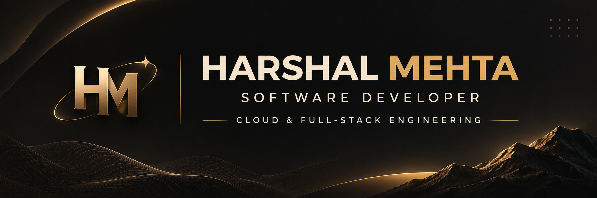

# HARSHAL MEHTA
### Software Developer · Full-Stack Engineer · Technology Enthusiast

  

## 01. THE PERSON BEHIND THE CODE

Hello! I'm **Harshal Mehta**, an Information Technology undergraduate at **K. J. Somaiya Institute of Technology**, with a Diploma in Computer Engineering.

I'm interested in the engineering behind digital products — how applications are designed, how systems communicate, how data moves, and how technology can transform an idea into something people can actually use.

I enjoy working across the development lifecycle, from understanding requirements and planning architecture to implementation, integration, deployment and refinement.

### My engineering interests

| Domain | What I enjoy exploring |
|---|---|
| Full-Stack Engineering | Building complete web applications, dashboards and workflow-driven platforms |
| Backend Development | API design, authentication, database architecture and real-time communication |
| Cloud Engineering | Cloud storage, infrastructure integrations and deployment workflows |
| Mobile Development | Cross-platform applications and practical mobile experiences |
| Data Science & AI | Data processing, analytical workflows and machine learning integrations |
| Interactive Web Experiences | Modern interfaces, animation systems and immersive digital experiences |

**My philosophy:** Build with purpose. Engineer with precision. Keep improving.

---

## ✦ SELECTED ENGINEERING WORK

A collection of applications, platforms and digital experiences I've contributed to — combining software engineering, cloud technologies, mobile development and thoughtful design.

---

### 01 / Creator Invoice Management Portal
**3Folks Media · Full-Stack Development**

A connected creator and administrative platform for campaign-linked invoice submissions, PDF generation, digital signatures, document management and financial approval workflows.

**Technology:** Node.js · Express.js · JavaScript · EJS · PostgreSQL · SQLite · AWS S3 · Socket.IO

  
  

### 02 / RapidWarn
**Disaster Reporting & Alert Platform · BMC Sponsored Project**

A disaster-response application designed to support citizen incident reporting through photo and video submissions, location-based mapping, notifications and AI-assisted media analysis.

**Technology:** Flutter · Dart · Firebase · Supabase · FastAPI · Python · YOLOv8 · FlutterMap

  
  

### 03 / MediTrail
**Personal Health Record Management System**

A healthcare platform focused on organising personal health records, medical documents and patient information through a structured digital experience.

**Technology:** Java · JavaScript · HTML5 · CSS3

  

### 04 / Aerqon Aviation
**Website Development · Aviation & Education**

Designed and developed a complete website for an aviation training and education brand, presenting its organisation, programmes, services and student-facing information.

**Technology:** HTML5 · CSS3 · JavaScript

  

### 05 / Jayco — A Samadhan App
**Jayco Safety Products Pvt. Ltd. · Mobile Application Development**

A Flutter-based mobile application developed during my app development internship, contributing to the company's mobile application experience.

**Technology:** Flutter · Dart

  

---

  <strong>FIVE PROJECTS. DIFFERENT CHALLENGES. ONE CONTINUOUS ENGINEERING JOURNEY.</strong>

## 04. TECHNICAL EXPERTISE

My technical interests span the complete application development lifecycle — from frontend experiences to backend architecture, databases and cloud integrations.

### FRONTEND ENGINEERING

`HTML5` `CSS3` `JavaScript` `React` `TypeScript` `Next.js`

Building responsive interfaces, interactive experiences and structured frontend applications.

### BACKEND & API ENGINEERING

`Node.js` `Express.js` `Python` `FastAPI`

Developing server-side applications, REST APIs, application workflows and backend integrations.

### MOBILE APPLICATION DEVELOPMENT

`Flutter` `Dart`

Building cross-platform mobile applications and integrating application features.

### DATABASES & DATA MANAGEMENT

`MySQL` `PostgreSQL` `SQLite` `MongoDB` `Firestore` `Supabase`

Working with relational and NoSQL databases, structured data and application persistence.

### CLOUD & INFRASTRUCTURE

`AWS S3` `Firebase` `Render` `Vercel`

Exploring cloud storage, backend services, deployment and hosting workflows.

### REAL-TIME SYSTEMS & TOOLS

`Socket.IO` `WebSockets` `Git` `GitHub` `Figma` `Canva`

Working with real-time communication, version control and interface design tools.

---

## 05. ACADEMIC FOUNDATIONS

### K. J. SOMAIYA INSTITUTE OF TECHNOLOGY

**Bachelor of Technology — Information Technology**

2026 — 2029

Currently pursuing undergraduate studies in Information Technology, strengthening my foundation in computing, software engineering and emerging technologies.

### SHREE BHAGUBHAI MAFATLAL POLYTECHNIC & COLLEGE OF ENGINEERING

**Diploma — Computer Engineering**

2023 — 2026

Developed a foundation in computer engineering, programming, databases and application development.

---

## 06. BEYOND THE TERMINAL

Technology is constantly evolving, and so is the way I approach engineering.

I'm particularly interested in:

- Building products that solve practical problems.
- Exploring modern software architecture and cloud technologies.
- Understanding the intersection of data science and application development.
- Creating digital experiences that balance functionality and design.
- Learning by building, experimenting and refining.

I believe the best way to understand technology is to work with it, question it and create something meaningful with it.

---

## CONNECT WITH ME

  
  &nbsp;
  
  &nbsp;
  
  &nbsp;
  

  <strong>Ideas are everywhere. I enjoy engineering the ones worth building.</strong>

  From designing intuitive interfaces to engineering backend systems and integrating cloud infrastructure,
  I build digital products with a focus on functionality, thoughtful design and real-world impact.

---

  <strong>THINK DEEPLY. BUILD BOLDLY. KEEP EVOLVING.</strong>

  Thanks for visiting my corner of GitHub.

